# Falco Test Lab

Manage Workers → load a linked Worker → **Open Test Lab** creates a disposable Cloudflare **Worker Preview** under that same Worker. The existing generated `falco-test-lab` Mock Worker is excluded and remains unrelated. The editor stays in the DOM with its unsaved values preserved. Starting with unsaved edits requires an explicit choice to keep those edits while testing saved source.

Choose Gemini or OpenAI and a model. Supply a dedicated key through `FALCO_TEST_LAB_API_KEY` in Studio's process environment or the launch password field. Starting a session authorizes one bounded real provider verification request. Subsequent messages also use that provider and may incur charges. Production secrets are never retrieved.

## Isolation and lifecycle

The backend uses the existing Wrangler adapter, Cloudflare profiles, account selection, project locks, local authentication token, tracked jobs, progress events and operation history. Studio conservatively allows one Lab at a time and blocks normal mutations, account changes and destructive operations until confirmed cleanup. Project locks also check persisted Lab state, preventing CLI project mutations during a session or recovery.

```mermaid
stateDiagram-v2
  [*] --> preparing
  preparing --> ready: Preview, secrets, health, chat and production verified
  preparing --> cleanup_required: failure and unconfirmed cleanup
  ready --> ending: End Test
  ending --> [*]: Preview absent and production unchanged; local files removed
  ending --> cleanup_required: deletion or verification uncertain
  cleanup_required --> ending: retry cleanup
  preparing --> emergency: production or session integrity failure
  ready --> emergency: security validation failure
  ending --> emergency: production or identity mismatch
```



Each UUID session lives in `.falco-test-lab/sessions/<uuid>/`. Its atomic manifest stores Worker/account/profile, Preview name and URL, provider/model, timestamps, state, production fingerprint, source revision/checksums and workspace location. Directories use mode 0700 and files 0600 where supported. Paths, regular files and symlinks are checked. The directory is excluded from Git and release packaging.

Test Lab snapshots compatible custom source and follows its local module dependencies. Custom modules are preserved, while recognized legacy Factory modules can receive compatibility updates **in the disposable workspace only**. The production upgrade fingerprint refusal is not used to reject a custom Preview. Package imports, dynamic/CommonJS dependencies, imports outside `src`, custom entrypoints/build settings and unsupported resource bindings require an isolated adapter. A custom runtime must support Client Action protocol 2. The reviewed Movens authentication wrapper is preserved: its Preview uses the Lab token as an ephemeral gateway credential with its original profile. No production gateway secret is copied or retrieved. Production KV knowledge and budget bindings are omitted, embedded test knowledge replaces the copied business context, and a random positive rate limiter namespace is generated independently of production. Opening and ending a Lab do not change normal project source or configuration.

## Cloudflare integration

Wrangler remains pinned to **4.166.0**. The installed CLI help and source were checked for these commands and its JSON response shape:

```text
wrangler preview --name <preview> --worker-name <worker> --ignore-base-config --json --config <session-config>
wrangler preview secret bulk <temporary-json> --name <preview> --worker-name <worker> --config <session-config>
wrangler preview secret list --name <preview> --worker-name <worker> --json --config <session-config>
wrangler preview delete --name <preview> --worker-name <worker> --skip-confirmation --config <session-config>
```

Creation returns `{ preview: { id, name, urls, ... }, deployment: { id, ... } }`. The adapter reads `preview.urls`, validates HTTPS and the workers.dev hostname, refuses the production hostname, and confirms the exact Preview identity and URL through the Preview API. It never derives URLs from an account subdomain or uses deployment/version URLs. A Preview name that already exists is refused before creation.

Worker-level Preview URL routing must already be enabled in Cloudflare. A successful Preview upload can otherwise return valid IDs with an empty URL list. Studio checks `/workers/scripts/<worker>/subdomain` during eligibility and again before creation, and explains disabled/unknown routing before deploying a Preview or uploading secrets. It does not enable that production routing setting or redeploy code. Enabling it is a separate authorized setup change and can also make existing Version URLs reachable. The parser reports identity, deployment-ID and missing-URL failures separately; it never substitutes a Unique Deployment URL for a missing Preview URL.

Read-only API checks use `/workers/workers/<worker>/previews/<preview>` and `/deployments/latest`, matching the installed Wrangler implementation. Secret installation creates another Preview deployment, so verification reads **latest after secret bulk**. An exact secret-name allowlist rejects unexpected secrets. `--ignore-base-config` prevents relying on dashboard defaults; no global Preview Base settings or secrets are changed. Preview observability enables invocation logs and traces with full sampling.

Deletion requires a successful exact Preview deletion command followed by API-confirmed absence. An already absent Preview can be cleaned up idempotently. API permission failures and ambiguous results keep the manifest and workspace in `cleanup_required`. Production fingerprint checks use the existing script deployment/settings/subdomain reader, independently of Preview metadata. Production changes raise a persistent emergency; no restoration deployment is attempted. The existing `stageDeployment()` Version URL workflow is unchanged.

References: [Preview configuration](https://developers.cloudflare.com/workers/previews/configuration/), [resources and isolation](https://developers.cloudflare.com/workers/previews/resources/), [get started](https://developers.cloudflare.com/workers/previews/get-started/), [Wrangler commands](https://developers.cloudflare.com/workers/wrangler/commands/workers/).

## Authentication and actions

A generated entrypoint authenticates every Preview request using `FALCO_TEST_LAB=true` and a random `FALCO_TEST_TOKEN`. It compares fixed-size SHA-256 digests without early-exit string comparison and strips Authorization before forwarding to the copied Worker. The token stays in backend memory; the browser receives neither that token nor the provider key in any response. Secrets are uploaded from a protected temporary JSON file removed in `finally`. Raw Wrangler output never enters progress/history; transient diagnostic logs are removed after commands.

The browser talks exclusively to Studio's loopback server. Chat requests require the existing local token. Proxy URLs and routes are fixed, responses and histories are bounded, redirects are refused, and only allowlisted chat/action metadata is returned. Known credentials and credential-shaped fields are redacted. CSP remains `connect-src 'self'`.

Celebrate, Cry and Sing work immediately when clicked, without contacting Falco or adding chat messages. When asked in chat, Falco proposes the corresponding action through Preview `/chat`; the shared `createActionController` validates it and calls the same fixed effect handler, then sends the actual result back using action protocol 2. Effects honor reduced motion. A sixth action, `ui.write_text`, lets Falco place the requested word or short text (1–100 characters) into the fixed playground textbox. The textbox also accepts direct user input; neither direct typing nor manual effect buttons contact the provider.

Proposals, confirmations and results are displayed in natural language. A creation card summarizes the record type, name, optional amount and date, with a specific button such as **Create expense** and **Cancel**. Raw action IDs, parameter JSON and result metadata are available in collapsed **Technical details**. Cancelled, failed and unknown outcomes have distinct messages and never display success. API Inspector retains the actual HTTP request/response details.

After installing these changes, end any existing test using **End Test**, restart Studio, and create a fresh test so its deployed Preview receives the seven-action manifest and updated instructions. Refreshing an existing Preview does not update its action catalog.

The fixed Toy API supports fictional `customer`, `weekly_expenses` and `product` reads, and bounded customer/expense/product creation. It has no business backend, SQL, arbitrary URL or executable endpoint support. UUID action request IDs provide write idempotency and conflicting-payload detection. At most 100 writes are allowed per session.

The **Try asking Falco** suggestion chips send real chat prompts for customer lookup, weekly expenses, product stock, expense creation, an incomplete reservation request, and a complete reservation request. They use the same chat/action pipeline as free-form messages; the independent Celebrate/Cry/Sing buttons remain local controls.

`toy.create_reservation` requires both `name` (2–100 characters) and a valid `date` in YYYY-MM-DD format. Instructions tell Falco to ask for missing fields, retain explicit answers from conversation history, and never invent details. Only after both fields are supplied should it propose the action. The browser then presents a natural-language confirmation. The fixed `POST /api/test-lab/sessions/<id>/toy-db/reservations` endpoint independently rejects missing/invalid fields, returns a fictional `reservationId`, shares the bounded per-session write limit and enforces idempotency. Actual POST calls and validation errors appear in API Inspector. A reservation does not check real availability or contact a business backend.

To test the missing-information flow, choose **Make a reservation**, supply only your name when asked, then supply a date. Inspect that no reservation POST occurs until the fields are complete and you confirm. Use **Reserve with all details** to compare the one-message flow. Browser tests cover this sequence using a fake provider; actual Gemini/OpenAI questioning behavior remains a live provider check.

Studio initializes its browser action controller when the session becomes ready, including when earlier polls already observed the same session preparing. Chat stays disabled until that controller exists. Later status polls retain it and its invocation ledger. Browser regression coverage holds creation in preparing before exercising proposals, then replays a confirmed write across a status poll to verify the Toy API is not executed twice.

API Inspector shows actual GET/POST calls, action/request IDs, endpoint, query, payload, HTTP status, response, duration, outcome and write idempotency key. Request/response details expand into JSON with copy controls. The latest 200 redacted records are atomically persisted in `api-calls.jsonl` and remain readable during restart cleanup. Provider/model, diagnostic request ID and measured proxy latency appear separately; upstream headers and credentials are excluded.

## End Test and recovery

The session header separates Worker, model, Preview identity and health into labeled fields, with a readable status badge. **End Test** has a power icon and cleanup helper text; the same control becomes **Retry cleanup** when recovery is needed. This visual update only requires refreshing Studio and can be used with an existing session. The main Studio logo has two lights following its drawn ellipses using CSS motion paths; reduced-motion preferences keep them stationary.

**End Test** asks for confirmation, locks the session, disables chat/actions, cancels or waits for in-flight work, validates persisted identities, deletes only its Preview, checks absence and production integrity, then removes session files. The editor becomes visible with its original buffer and controls.

The banner and `beforeunload` warning remain while a session is active. Switching Workers is blocked with an explicit message. Browser-managed shutdown considers active/recoverable Labs busy. A forced process stop retains session metadata. The next Studio process offers **Retry cleanup** with chat disabled because keys/tokens were never persisted. Complete cleanup before starting another session.

Red **EMERGENCY MODE** is reserved for template markers in managed/production content, fingerprint changes, identity/account mismatches or uncertain security/metadata integrity. Actions, Knowledgebase and Instructions are inspected independently, including live content during refresh and launch. It blocks normal editing and mutations. Review the exact reason, Worker/account, session and recovery instructions. Review Cloudflare against a trusted production baseline; clean up any Preview separately. Stop Studio and archive the emergency record only after manual integrity review. Corrupt/unsafe metadata must be repaired from trusted identity records. Studio never overwrites production to recover.

## Validation and remaining live checks

Run `npm test` for unit/API/regression tests and `npm run test:lab-browser` for the Playwright Lab flow. `FALCO_CHROMIUM` may point to an installed Chromium/Edge executable. Browser tests use actual Studio routes and action controllers with fake Wrangler, Cloudflare and provider adapters. Tests create/delete no real resources.

The CLI lifecycle test passes `--root <temporary-workspace>` so it does not load or rewrite a developer's active Test Lab recovery state. The Studio CLI accepts this optional workspace argument; normal launches continue using the Factory directory.

Development validation does not include live Cloudflare operations. Separate explicit authorization, a Cloudflare connection and a dedicated Gemini/OpenAI key are required to verify account Preview permissions/availability, URL propagation, secret installation, observability and deletion against Cloudflare. Studio cannot serialize external dashboard/API actors; production changes during a session trigger emergency review. Custom authentication beyond the reviewed Movens wrapper, external dependencies and resource bindings require isolated adapters. The Lab is single-session per Studio; concurrent session requests are serialized/rejected. Restrictive filesystem permissions are best effort on Windows and depend on the parent directory ACL.

## Implementation report

Implemented and tested locally: protected workspace generation, canonical templates, authentication wrapper, session state machine, server proxy, Toy API, Inspector, emergency detection, lifecycle guards and browser UI. Mock-verified Cloudflare operations: exact Preview commands, profile/account propagation, secret upload/list allowlist, JSON URL parsing, latest deployment verification, failed-creation cleanup, deletion confirmation and restart recovery. Verified against real Cloudflare: **none**; no real resources were created, changed or deleted during implementation.

Local validation on November 27, 2026:

- `npm test`: **232 passed, 0 failed, 0 skipped**, including **38 new Test Lab unit/API tests**. Custom module copying, unsupported imports, the reviewed Movens guard, empty Preview URL responses, disabled routing preflight, bounded textbox actions, natural-language outcomes and required reservation fields/idempotency/Inspector routes are covered. Production upgrade refusal for unknown source remains covered separately.
- `npm run test:lab-browser`: passed in installed Microsoft Edge through `FALCO_CHROMIUM`; checked eligibility, unsaved buffer preservation/decision, all three effect proposals and actual action feedback, free-form chat, GET, confirmed/cancelled POST, Inspector, mobile sizing, navigation/closure warnings, session header, End Test, restart cleanup and emergency UI. Orbital animation geometry was checked at desktop/mobile sizes along with reduced-motion behavior. Cloudflare and provider adapters were mocked.
- `npm run test:browser`: existing Studio/keyboard/mobile/action/privacy/tab-lifecycle suite passed.
- `npm run test:connections-browser`: existing OAuth job, account selection, project persistence/routing, reassignment, reauthentication, token exclusion and mobile suite passed with fake Cloudflare operations.
- `git diff --check`: passed.

Created files:

- `lib/test-lab.mjs`: state machine, recovery, integrity checks and proxy.
- `lib/preview-deploy.mjs`: Preview-only Wrangler/Cloudflare adapter.
- `lib/test-lab-workspace.mjs`: safe source/config generation and entrypoint wrapper.
- `lib/test-lab-source.mjs`: bounded source snapshots, local dependency graph and reviewed Preview adapters.
- `lib/test-lab-templates.mjs`: canonical actions, knowledge, instructions and markers.
- `lib/test-lab-api.mjs`: deterministic session database, idempotency, redaction and bounded logging.
- `ui/test-lab.js`: playground, chat/action flow, confirmations, Inspector and recovery UI.
- `ui/test-lab-actions.js`: natural-language action summaries, confirmations and outcome messages.
- `tests/test-lab.test.mjs`, `tests/test-lab-ui.test.mjs`: unit/lifecycle/security/HTTP coverage.
- `tests/test-lab-actions.test.mjs`: textbox action boundaries and natural-language confirmation/result coverage.
- `tests/helpers/test-lab.mjs`: isolated fake Wrangler/Cloudflare/provider fixtures.
- `tests/fixtures/movens-auth.mjs.txt`: reviewed authentication guard fixture.
- `tests/e2e/test-lab.mjs`: actual browser integration flow with mocked remote services.
- `docs/TEST_LAB.md`: setup, architecture, security, recovery, limitations and this report.

Modified files: `lib/ui-server.mjs` (routes/assets/jobs/guards), `lib/project-files.mjs` (persisted Lab mutation guard), `lib/projects.mjs` and `lib/project-refresh.mjs` (independent template detection), `ui/app.js`, `ui/index.html` and `ui/styles.css` (Studio integration), `.gitignore` and `scripts/package-release.mjs` (workspace exclusion), `package.json` (browser test command), and `README.md` (entry documentation). No dependency was added or upgraded; production Worker templates and the old staging workflow were not modified.
